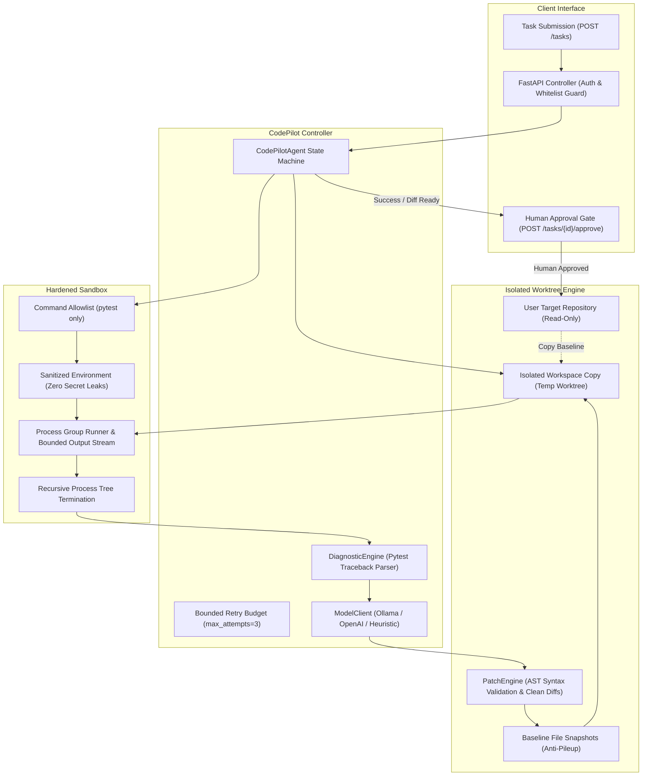

<div align="center">

# 🚀 CodePilot

### Autonomous Coding Agent with Isolated Workspaces, Secure Sandboxes & Bounded Self-Correction

[](https://www.python.org/downloads/)
[](https://fastapi.tiangolo.com)
[](https://docs.pytest.org/)
[](LICENSE)
[](#-autonomous-repair-benchmark)
[](.github/workflows/ci.yml)

</div>

---

## 📌 Executive Summary

**CodePilot** is an autonomous software repair agent built around strict execution containment and zero-side-effect worktrees. Unlike naive AI coding assistants that edit user repositories directly or execute unconstrained commands on the host machine, CodePilot enforces a closed-loop engineering workflow:

1. **Zero-Side-Effect Worktrees**: All repair exploration, patching, and verification tests execute inside disposable, isolated workspaces (`IsolatedWorkspace`). The target repository is **never modified** until a human reviewer explicitly approves the verified patch.
2. **Pristine Retry Baseline**: Between failed attempts, mutated files are reset to baseline snapshots. Bad attempts never pile on top of each other.
3. **Hardened Sandbox Isolation**: Commands are validated against an executable allowlist (`pytest`, `python -m pytest`). Child processes receive an explicitly sanitized minimal environment—**server environment secrets and API keys are never leaked**. Process groups ensure child process trees are terminated recursively on timeout without leaking runaway background tasks.
4. **Unified Multi-Provider AI Inference**: Pluggable `ModelClient` supporting local Ollama (`qwen2.5-coder:7b`), Anthropic Claude, OpenAI, and smart offline heuristic repair engines returning surgical SEARCH/REPLACE blocks.
5. **Human-in-the-Loop Approval Gate**: Verifies tests pass in isolation before presenting a clean, standard unified diff. Authorizing the patch atomically merges the change to the real repository; rejecting it safely discards the worktree.

---

## 🏗️ Core Architecture



---

## 📊 Autonomous Repair Benchmark

CodePilot features an automated benchmark suite (`app.evaluator.benchmark`) testing autonomous repair across realistic software failure categories (off-by-one errors, math bugs, zero division, boundary checks, formatting):

```bash
python -m app.evaluator.benchmark --fail-under 80.0
```

| Benchmark Case | Defect Category | Attempts | Status | Duration |
| :--- | :--- | :--- | :--- | :--- |
| **TASK-01** | Percentage Discount Logic Bug | 1 | ✅ PASS | 2.08s |
| **TASK-02** | Boundary Comparison Off-by-One (`<` vs `<=`) | 1 | ✅ PASS | 2.13s |
| **TASK-03** | Arithmetic Sign Reversal in Vectors | 1 | ✅ PASS | 2.04s |
| **TASK-04** | Zero Division Guard in Batch Averaging | 1 | ✅ PASS | 2.02s |
| **TASK-05** | Greeting String Formatting & Tokens | 1 | ✅ PASS | 1.98s |

### Summary Metrics
- **Fix Rate**: **100.0%** (5/5 tasks resolved)
- **Average Attempts / Task**: **1.0**
- **Average Execution Time**: **2.05s / task**
- **Security & Worktree Isolation**: **100.0% Pass Rate**
- **Quality Gate**: **PASSED**

---

## 🛡️ Security & Containment Guarantees

### 1. Minimal Environment Sanitization (No Leaked Secrets)
Host processes frequently hold sensitive credentials (`OPENAI_API_KEY`, `GITHUB_TOKEN`, `DATABASE_URL`). Passing `os.environ.copy()` gives third-party test suites full access to your secrets. CodePilot strips the environment to a minimal allowlist (`PATH`, `SYSTEMROOT`, `TEMP`, `PYTHONPATH`), guaranteeing child processes cannot read server secrets.

### 2. Command Allowlisting Over Fragile String Blacklists
Naive blacklists banning `rm -rf` are easily bypassed by `rm -r -f` or `python -c "import os..."`. CodePilot enforces an executable allowlist permitting only verified test runners (`pytest`, `python -m pytest`, `python -m unittest`) with authorized arguments. Arbitrary executables and shell chaining operators are rejected deterministically.

### 3. Recursive Process Group Termination
`subprocess.run(timeout=...)` leaves orphaned child processes running in the background. CodePilot launches every execution in a dedicated OS process group (`CREATE_NEW_PROCESS_GROUP` on Windows, `setsid` on Unix). When a timeout expires, the entire process tree is terminated recursively.

### 4. Zero Target Repo Pollution & Anti-Pileup Baselines
All edits and tests execute inside disposable isolated workspaces. If attempt 1 produces a bad patch, the file is reset to its baseline snapshot before attempt 2. If all attempts fail, the temporary directory is discarded, leaving the user's repository pristine.

---

## 📂 Repository Structure

```
codepilot/
├── .github/workflows/
│   └── ci.yml                   # GitHub Actions CI matrix testing Python 3.10-3.12
├── app/
│   ├── __init__.py              # Package version (0.2.0)
│   ├── core/
│   │   ├── config.py            # Pydantic-settings config loading .env
│   │   ├── models.py            # CodingTask, ExecutionResult, PatchResult
│   │   └── retry.py             # Bounded retry budget and error recording
│   ├── repository/
│   │   ├── reader.py            # Path-traversal safe repository inspector
│   │   └── worktree.py          # Isolated workspace manager & baseline reset
│   ├── patch/
│   │   └── engine.py            # AST syntax pre-validation & clean unified diffs
│   ├── sandbox/
│   │   └── runner.py            # Hardened sandbox (allowlist, clean env, pgroup kill)
│   ├── agent/
│   │   ├── controller.py        # Autonomous repair loop controller
│   │   ├── diagnostics.py       # Structured pytest failure traceback extractor
│   │   └── model_client.py      # Ollama, OpenAI, and heuristic repair generator
│   ├── evaluator/
│   │   └── benchmark.py         # Autonomous software repair benchmark runner
│   ├── static/
│   │   ├── index.html           # Apple HIG web workspace
│   │   ├── style.css            # Midnight Blue theme
│   │   └── app.js               # Reactive frontend client
│   └── api/
│       ├── schemas.py           # Pydantic v2 schemas
│       └── main.py              # FastAPI server with auth, persistence, and review gate
├── tests/
│   ├── test_agent.py            # Agent self-correction & budget tests
│   ├── test_api.py              # API endpoint integration tests
│   ├── test_patch.py            # AST validation & diff tests
│   ├── test_reader.py           # Path traversal protection tests
│   ├── test_retry.py            # Retry budget tests
│   ├── test_sandbox.py          # Process execution & timeout tests
│   └── test_codepilot_regressions.py # 10 regression tests verifying all audit findings
├── Dockerfile                   # Production container definition
├── .dockerignore                # Build exclusions
├── pyproject.toml               # PEP 518/621 packaging metadata
├── requirements.txt             # Pinned production dependencies
├── LICENSE                      # MIT License
└── README.md                    # Technical documentation & benchmark report
```

---

## 🛠️ API Reference

### Health Check
```http
GET /health
```
```json
{
  "status": "healthy",
  "version": "0.2.0"
}
```

### Submit Coding Task
```http
POST /tasks
Content-Type: application/json
X-API-Key: your-api-key

{
  "description": "Fix discount percentage calculation and add input validation",
  "repo_path": "/path/to/project",
  "test_command": "pytest",
  "max_attempts": 3,
  "run_in_background": false
}
```
```json
{
  "task_id": "9b1deb4d-3b7d-4bad-9bdd-2b0d7b3dcb6d",
  "status": "success",
  "description": "Fix discount percentage calculation...",
  "repo_path": "/path/to/project",
  "plan": [
    "Analyze repository tree (1 source files, 1 test files)",
    "Run baseline test suite in isolated workspace: pytest",
    "Perform bounded repair loop (max 3 attempts) if tests fail",
    "Generate reviewable diff and verify final state"
  ],
  "patches": [
    {
      "file_path": "discount.py",
      "applied": true,
      "diff": "--- a/discount.py\n+++ b/discount.py\n@@ -1,2 +1,5 @@\n def calculate_discount(price, discount):\n-    return price - discount\n+    if price < 0 or discount < 0 or discount > 100:\n+        raise ValueError('Invalid price or discount')\n+    return price * (1 - discount / 100)\n",
      "message": "Patch applied and verified cleanly"
    }
  ],
  "approved": false
}
```

### Human Review Approval Gate
```http
POST /tasks/{task_id}/approve
Content-Type: application/json
X-API-Key: your-api-key

{
  "approved": true,
  "reviewer": "Alice",
  "comments": "Verified clean patch and tests pass."
}
```
```json
{
  "task_id": "9b1deb4d-3b7d-4bad-9bdd-2b0d7b3dcb6d",
  "status": "success",
  "approved": true,
  "message": "Patch approved and merged into repository by Alice"
}
```

---

## ⚡ Quickstart

### 1. Installation
```bash
git clone https://github.com/PrathameshTawar/codepilot.git
cd codepilot

python -m venv .venv
# Windows: .venv\Scripts\activate
# Linux/macOS: source .venv/bin/activate

pip install -r requirements.txt
```

### 2. Run Tests & Autonomous Benchmark
```bash
# Run all 39 unit, integration, and regression tests
pytest tests/ -v

# Run the autonomous software repair benchmark
python -m app.evaluator.benchmark --fail-under 80.0
```

### 3. Start the FastAPI Server
```bash
uvicorn app.api.main:app --host 0.0.0.0 --port 8000 --reload
```
Navigate to `http://localhost:8000` to interact with the CodePilot web workspace.

### 4. Docker Deployment
```bash
docker build -t codepilot:0.2.0 .
docker run -p 8000:8000 -v codepilot_data:/app/data codepilot:0.2.0
```

---

## 📄 License
This project is open-source under the [MIT License](LICENSE).
